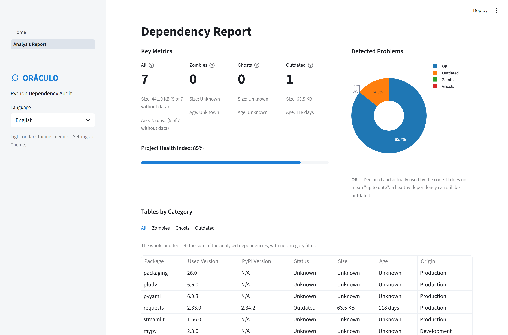

*[Versão em português](README.md)*

# ORÁCULO

**ORÁCULO** — *Organizador e Rastreador Automático de Código, Uso de Libraries e Ocorrências*
(Portuguese for "automatic organiser and tracker of code, library usage and occurrences").


Web tool for auditing Python project dependencies. It crosses what a Target Project
**declares** it depends on with what its code **actually imports**, and confronts both against
PyPI to report Zombies, Ghosts and Outdated ones.

> **Context:** academic work (RP III, Marco I) kept as a portfolio piece — the interface
> defaults to English ([ADR-0009](docs/adr/0009-locales-em-json-sem-biblioteca-de-i18n.en.md)),
> and the documentation stays in Portuguese.



*Self-audit report: ORÁCULO analysing its own code — 0 Zombies, 0 Ghosts, Health Index 85%.*

---

## Documentation

The domain model is not re-explained here — the capitalised terms throughout this README
(Target Project, Declaration, Lock, Zombie, Ghost, Used Version, Size, Age, Origin) have an
exact definition in the glossary:

| Document | What it is |
|---|---|
| [`CONTEXT.en.md`](CONTEXT.en.md) | Domain glossary — the exact definition of each term. |
| [`docs/adr/`](docs/adr/) | Decision records: **why** the non-obvious choices are the way they are. |
| [`docs/Enunciado.en.md`](docs/Enunciado.en.md) | Requirements and user stories (US-01…US-07). |

---

## Features

### Audit categories

- **Zombies** — declared Production Dependencies that no Root Import of the code uses.
- **Ghosts** — Root Imports of the code that no Declaration mentions. They work on the dev's
  machine by riding along as transitives, and break in another environment.
- **Outdated** — dependencies whose Used Version is older than the latest published on PyPI.
  It is not an exclusive Category: a dependency can be a Zombie **and** Outdated at the same
  time, so it comes out in a column of its own.

### Production vs. Development

Each package carries an **Origin** — which Declaration, and which section of it, it came from:

| Origin | Where it comes from | Becomes a Zombie? |
|---|---|---|
| **Production** | `[project].dependencies`, `[tool.poetry].dependencies`, `requirements.txt`, `environment.yml` | Yes |
| **Development** | `[dependency-groups]`, `[project.optional-dependencies]`, `[tool.poetry.group.*]`, `requirements-dev.txt` | **Never** |

A Development Dependency is never a Zombie
([ADR-0003](docs/adr/0003-dependencias-de-desenvolvimento-nunca-sao-zumbis.en.md)): tools like
`ruff` and `mypy` are imported by nobody, and the rest live precisely in the Exclusions.

### Metrics

- **Size** — bytes of the wheel (sdist as fallback) of the Used Version, as published on PyPI.
  It is **not** on-disk size and does not include transitives.
- **Age** — time between the Used Version's release date on PyPI and today. It measures how
  long the project has been sitting on that version, not the package's age.
- **Health Index** — the proportion of Declared Dependencies that are neither Zombies, Ghosts
  nor Outdated.

Size and Age come from PyPI metadata, not from disk
([ADR-0004](docs/adr/0004-tamanho-e-idade-vem-dos-metadados-do-pypi.en.md)) — a single request
to `/pypi/NAME/json` per package brings all three. Without a resolved Used Version, both come
out as **Undetermined**: ORÁCULO does not invent a version.

### Report

- Statistics of summed Size and average Age **stratified by Category**, with a warning of how
  many dependencies were left out of each aggregation.
- Export to **CSV** and **JSON**.
- Parallel queries to PyPI, to reduce analysis time.

---

## Supported Formats

The audited set comes **only from the Declarations**; the Lock merely resolves which version
each item of that set is at
([ADR-0002](docs/adr/0002-declaracao-define-o-conjunto-lock-define-a-versao.en.md)).

| File | Manager | Role |
|---|---|---|
| `pyproject.toml` | PEP 621, Poetry | Declaration — defines the set (Production and Development) |
| `requirements.txt` | pip | Declaration — Production |
| `requirements-dev.txt` | pip | Declaration — Development |
| `environment.yml` | Conda | Declaration — Production |
| `uv.lock`, `poetry.lock` (`*.lock`) | uv, Poetry | **Lock** — resolves the Used Version; never defines the set |

A Target Project may have several Declarations, and all of them count: the set is their union,
deduplicated by Distribution Name, preserving the Origin.

> **Why the Lock does not define the set:** a `uv.lock` lists hundreds of transitives that no
> code imports. Reading it as a Declaration would make every transitive become a Zombie.

Adding a format = writing the parsing function and decorating it with
`@registrar(READERS, "<file>")` in `core/parsin/readers.py`. No new `if` in `pages/`.

---

## Known limitations

### Import Alias resolution by table

When the Import Name differs from the Distribution Name (`import yaml` ↔ `PyYAML`, `sklearn` ↔
`scikit-learn`, `cv2` ↔ `opencv-python`, `PIL` ↔ `Pillow`), the match uses a fixed alias table
(`IMPORT_ALIASES` in `utils/constants.py`). The table covers the most common mismatches of the
ecosystem, but is **not exhaustive**: a package with diverging names not in the table still
generates **two false positives** — it becomes a Ghost (the import matches no declaration)
**and** a Zombie (the declaration matches no import) at the same time. A conscious mitigation,
not a complete solution; extending the table resolves it case by case.

### Ingestion by upload only

[ADR-0001](docs/adr/0001-ingestao-por-upload-e-por-diretorio.en.md) decides to support
ingestion by upload **and** by local directory. Today only upload is implemented.

---

## Project Structure

```
.
├── core/                            # Core logic — nothing here imports streamlit
│   ├── ingestion/
│   │   ├── decompressor.py          # Reads .zip, .tar and .tar.gz in memory
│   │   ├── archive_walker.py        # Walks the archive and reads the files that matter
│   │   └── filter.py                # Exclusions, archive validation and ignored folders
│   │
│   ├── parsin/
│   │   ├── readers.py               # Parsers registered by file (READERS)
│   │   ├── declaration_collector.py # Unions all Declarations into the audited set
│   │   ├── lock_resolver.py         # Resolves the Used Version from the Lock
│   │   ├── dependency_parser.py     # Normalises and standardises the declared list
│   │   └── import_parser.py         # Extracts Root Imports via AST
│   │
│   ├── analysis/
│   │   ├── zombie_analizer.py       # Declared Production not imported
│   │   ├── ghost_analizer.py        # Root Imports not declared
│   │   ├── outdated_analizer.py     # Compares Used Version with the PyPI version
│   │   └── name_matching.py         # Import Alias: Distribution ↔ Import Name
│   │
│   ├── pypi/
│   │   └── pypi_client.py           # Public PyPI API: version, Size and Age
│   │
│   └── report/
│       ├── normalization.py         # Final data structuring for display
│       ├── statistics.py            # Summed Size and average Age per Category
│       └── export.py                # Export to CSV and JSON
│
├── pages/                           # Streamlit interface
│   ├── home.py                      # Target Project upload and Exclusions choice
│   ├── loading.py                   # Orchestrates the pipeline with per-step feedback
│   └── report.py                    # Report, metrics and charts
│
├── utils/
│   ├── constants.py                 # Colours, PyPI URL, stdlib, IMPORT_ALIASES
│   ├── functions.py                 # READERS and EXTRATORES registries (decorator)
│   └── sidebar.py                   # Reusable sidebar
│
├── tests/units/                     # Unit tests mirroring core/, pages/ and utils/
│   ├── analysis/
│   ├── ingestion/
│   ├── pages/
│   ├── parsin/
│   ├── pypi/
│   ├── report/
│   └── utils/
│
├── docs/
│   ├── Enunciado.md                 # Requirements and user stories
│   ├── adr/                         # Architecture decision records
│   └── grills_logs/                 # Grill-session logs
│
├── CONTEXT.md                       # Domain glossary
├── main.py                          # Entry point — Streamlit navigation
├── pyproject.toml                   # ORÁCULO's own dependencies
└── uv.lock                          # Lock generated by uv
```

---

## Analysis Pipeline

```
.zip / .tar / .tar.gz file
        │
        ▼
  decompressor.py          — opens the archive in memory (without extracting to disk)
        │
        ▼
  filter.py                — validates the archive and applies the Exclusions
        │
        ▼
  loading.py               — orchestrates the steps with visual feedback
        │
        ├──▶ declaration_collector.py → readers.py   — unions the Declarations (the set)
        │
        ├──▶ lock_resolver.py                        — Lock resolves the Used Version
        │
        ├──▶ import_parser.py                        — extracts Root Imports via AST
        │
        ├──▶ zombie_analizer.py / ghost_analizer.py  — crosses declared × imported
        │
        └──▶ outdated_analizer.py + pypi_client.py   — PyPI: version, Size and Age
                    │
                    ▼
              normalization.py → statistics.py   — consolidates and stratifies by Category
                    │
                    ▼
              report.py → export.py              — displays and exports CSV / JSON
```

---

## Installation and Running

**Prerequisites:** Python 3.11+

### With uv (recommended)

```bash
uv sync                        # install dependencies
uv run streamlit run main.py   # run the application
uv run pytest                  # run the tests
```

### With pip

```bash
python -m venv .venv
source .venv/bin/activate       # Linux/Mac
.venv\Scripts\activate          # Windows

pip install streamlit plotly requests packaging pyyaml
streamlit run main.py
```

---

## Application Dependencies

| Package | Use |
|---|---|
| `streamlit` | Web interface and page navigation |
| `plotly` | Report charts |
| `requests` | Requests to the PyPI API |
| `packaging` | Semantic version comparison in `outdated_analizer` |
| `pyyaml` | Reading `environment.yml` (Conda) in `readers` |

---

## Usage

1. Open `http://localhost:8501` after starting the application.
2. Upload the `.zip`, `.tar` or `.tar.gz` of the Target Project.
3. Optionally, mark the folders left out of the audit (Exclusions — e.g., `tests`, `docs`).
4. Click **Run Full Analysis** and follow the progress.
5. Read the report: general metrics, tables by Category (All, Zombies, Ghosts, Outdated), Size
   and Age stratified, and the charts.
6. Export the result to CSV or JSON.

> ORÁCULO itself is a valid Target Project — auditing it is the fastest way to test.

---

## License

Distributed under the [MIT](LICENSE) license — © 2026 Pietro Prauchner, Rafael Lopes, Lorenzo
Ficher and Inaurrara.

## Authors

Work by grupo-03 (RP III, Marco I):

- **Pietro Prauchner** — [@PPrauchner](https://github.com/PPrauchner)
- **Rafael Lopes** — [@rjnlopes03](https://github.com/rjnlopes03)
- **Lorenzo Ficher** — [@lorenzoficher](https://github.com/lorenzoficher)
- **Inaurrara** — [@Inaurrara](https://github.com/Inaurrara)
